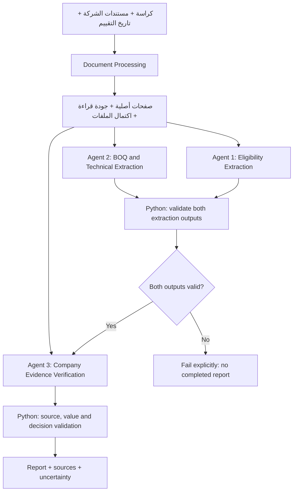

# TenderProof-Core: اقتراح Architecture لثلاثة مكونات AI
23 أكتوبر 2026 | اعتماد المستخدم: 24 أكتوبر 2026 - هيكل فقط، لا تنفيذ
نقطة البداية b5c732b. هذا سجل الاقتراح الذي تم اعتماده؛ أقسامه بصيغة المستقبل تحفظ تاريخ القرار. تم تجهيز models.py والواجهات فقط بعد الاعتماد، دون تنفيذ أو تغيير المرجع v0.6.0.
تفاصيل تمثيل مكملة: row/column تبدأ من 1؛ Report يحفظ verification_provenance وmanifest يحفظ completeness_basis؛ الأنواع لا تعني تنفيذ OCR.

## 1. نتيجة مراجعة الموجود
الملفات التنفيذية الستة مجرد signatures وNotImplementedError. models.py عقد TypedDict
تعليمي لا يفحص القيم أثناء التشغيل. agent2.py حاليًا يحمل verify_requirements؛
المراجع القديمة موجودة في README.md وTEAM_TASKS.md وtests/README.md.
لا توجد اختبارات سلوك فعلية ولا agent3.py. لا يوجد تنفيذ جاهز مطلوب نقله أو الحفاظ عليه.

## 2. الرحلة الجديدة


Agent 1 و2 يستقبلان صفحات الكراسة نفسها ويمكن تشغيلهما بالتوازي؛ التنفيذ المتوازي
ليس شرطًا لأول نسخة. Agent 3 لا يبدأ قبل اكتمال المخرجين وصحتهما البنيوية ومراجعة
مصادرهما. NOT_FOUND كحالة BOQ صريحة مخرج صالح، وليس معناه فشل Agent 2.
أما exception/رد ناقص من أحدهما فيمنع التقرير المكتمل. النتائج المؤقتة لا تتنكر كمراجعة مكتملة.

Validation ليس Agent ولا يحتاج LLM. نستخدم أسماء Agents التعليمية لكن التنفيذ المقصود
مكوّنات AI متخصصة داخل تسلسل برمجي، مش Autonomous Agents بأدوات وتخطيط حر.
لا RAG أو embeddings أو Vector DB أو retrieval pipeline.

## 3. حدود مسؤولية كل مكوّن
- Agent 1: شروط التأهيل ومستنداته والخبرة والتراخيص والمتطلبات الإدارية/المالية المرتبطة
  بالتأهيل، لا كل بند مالي في الكراسة ولا التزامات بعد الترسية تلقائيًا.
- Agent 2: BOQ إن وجد، بنود وكميات ووحدات، ومواصفات وموديلات ومواعيد فنية حتى لو مفيش BOQ.
- Agent 3: يختار الأدلة المؤيدة والمعارضة لكل هدف، ويفسر النقص والتعارض، ويقترح الحالة.
  يطابق أيضًا العناصر الفنية/الكمية مع العرض إن وُجد؛ لا يفترض وجود عرض فني في كل ملف شركة.
- Validation: يفحص الاقتباسات والقيم والتاريخ والحسابات وتغطية كل هدف وحذر النتائج.
  المقارنات الرقمية المدعومة يحسمها Python؛ لا يعتمد على رقم حسبه LLM.
  إذا أخفقت بنية/مرجع: رفض صريح. إذا المعنى/القياس غير كافٍ: NEEDS_REVIEW.
- Orchestrator: يمرر المخرجات بين الخطوات، لا يبتكر الاستنتاجات أو يكمل مخرجًا ناقصًا بتخمين.

## 4. اقتراح models.py قبل اعتماده
نحافظ مبدئيًا على TypedDict للتعلم ومن غير تثبيت مكتبة. كل الحقول المدرجة مطلوبة
إلا ما نص عليه؛ القيم المجهولة تكون null في الحقول nullable، مش صفرًا أو نصًا مخترعًا.
TypedDict لا يكفي وحده: validate_document / validate_extractions / validate_report
لازمة أثناء التشغيل قبل الاعتماد على هذه القيم.
هذه عقود Core مقترحة مستقلة؛ الدمج مع API v1 لاحقًا يحتاج adapter وتقييمًا منفصلًا.

### الأنواع الأساسية والتعديلات
| النوع | الحقول المقترحة | القرار |
|---|---|---|
| Page | pdf_page, text, readability, extraction_method, tables, warnings | pdf_page يبدأ من 1؛ النص العربي كما خرج من الأصل بلا قلب/إصلاح صامت |
| DocumentPages | document_id, filename, role, completeness, completeness_basis, pages, warnings | role=TENDER/COMPANY؛ completeness=UNKNOWN/COMPLETE/INCOMPLETE؛ basis=UNKNOWN/USER_CONFIRMED/TEST_FIXTURE |
| Citation | document_id, pdf_page, quote | باقٍ كما هو؛ لا مصدر بلا اقتباس قابل للفحص |
| TableRegion | table_id, pdf_page, structure_quality, cells, warnings | structure_quality=RECOVERED/PARTIAL/UNREADABLE؛ لكل خلية row/column/text/sources |
| Requirement | requirement_id, text, category, needs_review, review_reasons, sources | EL-*؛ category=REGISTRATION/LICENSE/EXPERIENCE/ADMINISTRATIVE/FINANCIAL/OTHER؛ المصادر إلزامية |
| TechnicalRequirement | technical_id, text, category, needs_review, review_reasons, sources | TECH-*؛ category=SPECIFICATION/MODEL/EXECUTION_DEADLINE/OTHER |
| BOQItem | boq_item_id, description, quantity, unit, unit_normalized, table_id, needs_review, review_reasons, sources | BOQ-*؛ quantity وصف موثّق أدناه؛ table_id nullable للعنصر النصي الصريح |
| Finding | target_type, target_id, status, explanation, evidence, review_required, uncertainty_reasons | target_type=ELIGIBILITY/TECHNICAL/BOQ؛ لا نفترض أن كل finding شرط أهلية |
| Report | schema_version, mode, reference_date, documents, eligibility, technical, findings, coverage_confirmed, warnings | schema_version=core-draft-0.2؛ ليس public v1 |
| ExtractionProvenance | mode, provider, model, prompt_version | لكل مكوّن بمخرجه؛ لا نقدم Mock كأنه AI |

complete/confirmed تصف اكتمال المواد المقدمة وفق مصدر التصريح، ولا تثبت أصالة المستند
أو أن الشركة قدمت كل ما تملكه. role=COMPANY يشمل العرض الفني إذا رُفع.
documents داخل Report قائمة manifest: document_id وfilename وrole وcompleteness
والتحذيرات، من غير تكرار كل نصوص الصفحات.

### الصفحات والجداول العربية
الـPDF Reader قد يُرجع tables=[] رغم وجود جدول في الصورة؛ معناها لا جدول استُعيد بنيويًا،
مش إثبات لا BOQ. لا نساوي native text بجدول سليم. كل TableRegion له جودة مستقلة.
الخلية تحتفظ بالنص الأصلي ومصدره؛ row/column مواضع مستخرجة مش حقيقة مؤكدة عند PARTIAL.
لو قيمة من صورة مش موجودة في النص الأصلي، لا تمر كاقتباس نصي متحقق.
في النطاق الأول: تحتاج مراجعة، ولا ندعي visual grounding أو OCR منفّذ.
يمكن اختبار جدول واضح بDataset ثانية، وOCR قرار لاحق مستقل.

### الكميات والوحدات
Quantity مقترح: {raw_text, decimal_value, sources}.
raw_text يحفظ النص كما هو، مثل «١٢». decimal_value نص عشري canonical مثل "12" أو null؛
النص العشري يمنع تقريب float. sources تثبت تحديد الكمية، مش وصف البند فقط.
unit تحفظ «جهاز»، وunit_normalized nullable؛ لا نحول «علبة» إلى «قطعة» دون معامل موثق.
Python يتحقق بـDecimal من العدد، وعدم السلبية وحدود المجال، والتحويلات البيضاء المدعومة
ومصدرها. عدم وضوح عمود الكمية/الوحدة يمنع حكم مطابقة كمي قطعي.
لا نفترض exact/minimum/maximum من رقم BOQ وحده؛ نحتاج صياغة شرط المقارنة ومصدرها.
المواعيد الأصلية تبقى نصًا مع مصدر؛ تاريخ التقييم ISO صريح، والتاريخ المستنتج يحتاج
مرجعًا مؤكدًا. الغموض أو اختلاف التقويم أو نسبية المدة بلا نقطة بداية => مراجعة.

### أغلفة المخرجات
EligibilityOutput = {requirements: list[Requirement], provenance, warnings}.
TechnicalOutput = {boq_status, boq_review_reasons, boq_items: list[BOQItem],
technical_requirements: list[TechnicalRequirement], provenance, warnings}.
VerificationOutput = {findings: list[Finding], provenance, warnings}.

boq_status:
- FOUND: عُثر على بنود BOQ مسندة للمصدر، قائمة غير فارغة؛ العناصر الملتبسة تحمل review.
- NOT_FOUND: لم يعثر المكوّن على جدول BOQ ضمن النطاق المقدم، boq_items=[]؛ لا يثبت عدم وجوده
  في العالم أو اكتمال الكراسة. غموض قراءة/نطاق جوهري يستلزم NEEDS_REVIEW بدل الجزم.
- NEEDS_REVIEW: احتمال جدول أو صعوبة قراءة/ربط أعمدة؛ قد توجد عناصر جزئية مسندة فقط،
  مع أسباب صريحة، ولا يجوز ملء الناقص افتراضيًا.

TechnicalRequirements لا يلزم أن تكون فارغة عند NOT_FOUND.
خروج Agent 1 فارغًا لا يعني «الشركة مؤهلة»؛ يحفظ تحذير التغطية.
coverage_confirmed تبقى false في النسخة الأولية؛ إتمام التنفيذ ليس قياس recall.

### مقتطف Python مقترح داخل المستند فقط
الأنواع Page وCitation وRequirement وبقية الأنواع وفق الجدول أعلاه.
```python
class Quantity(TypedDict):
    raw_text: str
    decimal_value: str | None
    sources: list[Citation]

class TechnicalRequirement(TypedDict):
    technical_id: str
    text: str
    category: Literal["SPECIFICATION", "MODEL", "EXECUTION_DEADLINE", "OTHER"]
    needs_review: bool
    review_reasons: list[str]
    sources: list[Citation]

class BOQItem(TypedDict):
    boq_item_id: str
    description: str
    quantity: Quantity
    unit: str | None
    unit_normalized: str | None
    table_id: str | None
    needs_review: bool
    review_reasons: list[str]
    sources: list[Citation]

class TechnicalOutput(TypedDict):
    boq_status: Literal["FOUND", "NOT_FOUND", "NEEDS_REVIEW"]
    boq_review_reasons: list[str]
    boq_items: list[BOQItem]
    technical_requirements: list[TechnicalRequirement]
    provenance: ExtractionProvenance
    warnings: list[str]

class Finding(TypedDict):
    target_type: Literal["ELIGIBILITY", "TECHNICAL", "BOQ"]
    target_id: str
    status: Literal["SATISFIED", "CONTRADICTED", "MISSING_EVIDENCE", "NEEDS_REVIEW"]
    explanation: str
    evidence: list[Citation]
    review_required: bool
    uncertainty_reasons: list[str]
```

## 5. أمثلة JSON صناعية صغيرة - ليست تشغيلًا أو Ground Truth للكراسة
مثال مخرج فني صالح بلا BOQ، ما زال يصرّح بعدم إثبات تغطية الكراسة:
```json
{
  "boq_status": "NOT_FOUND",
  "boq_review_reasons": [],
  "boq_items": [],
  "technical_requirements": [],
  "provenance": {"mode": "MOCK", "provider": "mock", "model": "student-mock", "prompt_version": "example-only"},
  "warnings": ["No BOQ identified in supplied scope; overall coverage is unconfirmed."]
}
```

مثال بند جزئي يوضح حفظ العربي والعدد؛ جزء من BOQItem وليس كل مخرج Agent 2.
النصوص تفترض وجودها حرفيًا في صفحة صناعية 2، وليست اقتباسات من كراسة الهيئة:
```json
{
  "boq_item_id": "BOQ-0001",
  "description": "توريد طابعة",
  "quantity": {
    "raw_text": "١٢",
    "decimal_value": "12",
    "sources": [{"document_id": "synthetic-tender", "pdf_page": 2, "quote": "١٢"}]
  },
  "unit": "جهاز",
  "unit_normalized": null,
  "table_id": "table-p2-1",
  "needs_review": true,
  "review_reasons": ["Column association needs confirmation."],
  "sources": [{"document_id": "synthetic-tender", "pdf_page": 2, "quote": "توريد طابعة"}]
}
```

مثال Finding حين ملفات شركة نايل غير مؤكدة؛ لا نجزم بالغياب:
```json
{
  "target_type": "ELIGIBILITY",
  "target_id": "EL-0001",
  "status": "NEEDS_REVIEW",
  "explanation": "اكتمال مستندات نايل لخدمات تكنولوجيا المكاتب غير مؤكد.",
  "evidence": [],
  "review_required": true,
  "uncertainty_reasons": ["COMPANY_COMPLETENESS_UNKNOWN"]
}
```

الأمثلة ليست اختبار validation منفذًا؛ validator المطلوب لم يُكتب بعد.

## 6. قواعد قبول Validation المقترحة
1. الأنواع والقيم المسموحة والهويات فريدة، والصفحات متسلسلة من 1. التاريخ قيمة ISO صحيحة،
   لا مجرد regex؛ الأعداد finite Decimal ومصادرها موجودة.
2. كل مصدر للكراسة في A1/A2 من TENDER. أدلة A3 من COMPANY، والاسم المعروض من manifest.
3. Citation يطابق نص الصفحة بعد Unicode/whitespace فقط؛ لا fuzzy matching أو قلب ترتيب العربي.
   المصدر غير القابل للقراءة/الاقتباس يرفض، ولا نستبدله باقتباس مُصنّع.
4. قبل A3 نتحقق من المخرجين وكل sources وعلاقات Table IDs بالصفحات. شكل جدول غير مستعاد
   لا يسمح بوصف normalized quantity كحقيقة مؤكدة.
5. Finding واحدة لكل EL/TECH/BOQ معتمد كهدف؛ لا IDs غائبة أو مكررة أو أهداف مخترعة.
   no BOQ لا ينتج بندًا وهميًا اسمه «BOQ غير موجود». تحذير الحالة في TechnicalOutput فقط.
6. SATISFIED/CONTRADICTED تحتاج أدلة كافية ومقروءة، ومدخلًا غير ملتبس، وعدم شك مؤثر.
   CONTRADICTED مخالفة مثبتة، لا غياب ملف. كلاهما يحمل review_required=true في البداية.
7. MISSING_EVIDENCE فقط مع غياب مصدر مناسب ووضوح الشرط والقراءة واكتمال المواد المقدمة؛
   مش حكم عدم أهلية. UNKNOWN/INCOMPLETE أو غموض جوهري => NEEDS_REVIEW وأسباب صريحة.
8. المقارنة غير المدعومة أو الوحدة غير المتوافقة أو مدى/نفي غير مفهوم => مراجعة، لا تخمين.
   validation لا يضمن الدلالة أو أصالة الأوراق حتى لو كل الاقتباسات صحيحة.
9. فشل schema/source/API يوقف اكتمال التقرير؛ الغموض الممثل بعقد سليم قد يخرج تقرير مراجعة.
10. ممنوع Real AI provenance في Fake أو نتائج محفوظة، ولا تقرير يدعي اكتمال تغطية الشروط.

## 7. Interface تبديل المزوّد - اقتراح لا تنفيذ
ملف صغير واحد llm_client.py بعد الاعتماد، لا SDKs متعددة ولا مفاتيح داخل الكود.
```python
class LLMClient(Protocol):
    async def generate(
        self, *, instructions: str,
        input_data: dict, output_schema: dict
    ) -> LLMResponse: ...
```
LLMResponse: payload (dict), provider, model, usage (dict | None).
كل Agent يستقبل client بالـdependency injection ويملك Prompt وschema الخاصين به.
Adapter المزوّد يترجم الطلب وStructured Output ويرجع dict أو خطأ صريح؛ لا fallback صامت،
ولا retry تلقائي أو مفتاح في logs. validation المستقل مطلوب مهما كانت ضمانات المزوّد.
يمكن FakeClient للاختبارات؛ ليس AI حقيقيًا. لو المزود لا يدعم schema strict فالتوافق يحتاج
فحصًا محليًا صريحًا؛ لا نفترض أن نفس Prompt يعطي نفس السلوك بين OpenAI وGemini.
الفريق يختار المزوّد دون فرض SDK الآن. Luna هدف Integration بعد اختبار التوافق وموافقة
جديدة بعدد الطلبات والتكلفة. لم تُنفذ اتصالات أو تُراجع أسعار جديدة في هذه المهمة.

## 8. الملفات بعد اعتماد العقود - لم تُنشأ/تُعدل الآن
- models.py: اعتماد العقد أولًا بالتعاون مع الجميع، Member 5 مسؤول تجميع القرار.
- pdf_reader.py: Member 1 بدل ملكيته القديمة؛ لا نسخ NativePDFProcessor.
- agent1.py: Eligibility، Member 2، extract_eligibility(tender, client) -> EligibilityOutput.
- agent2.py: BOQ/Technical، Member 3، extract_technical(tender, client) -> TechnicalOutput.
- agent3.py: ملف جديد لاحقًا، Member 4،
  verify_company(eligibility, technical, documents, reference_date, client) -> VerificationOutput.
- validation.py: Member 5 ينسق source/value/output guards.
- orchestrator.py: Member 5 يربط بالبوابات السابقة؛ لا استدعاء A3 قبل A1 وA2.
- llm_client.py: Protocol واستجابة وحدود Adapter فقط؛ التنفيذ يكتبه الأعضاء عند الحاجة.
- tests: أسماء جديدة test_agent1 / test_agent2 / test_agent3 / test_validation /
  test_pdf_reader / test_orchestrator / test_contracts، باختبارات يكتبها الفريق.
- تحديث README وtests/README وdocstrings والتقسيم القديم في نفس خطوة اعتماد الأسماء.
  لا نترك verify_requirements في agent2.py بعد التحويل ولا نوحي أن الاسم القديم ما زال صحيحًا.

لا نقل Backend أو Frontend ولا تغيير ملفات أو حالات public v1 في D:\TenderProof-AI.

## 9. Dataset والبداية العملية
كراسة الهيئة العامة كما هي، ومستندات شركة افتراضية متسقة:
نايل لخدمات تكنولوجيا المكاتب / Nile Office Technology Services.
كل PDF صناعي يحمل Synthetic بوضوح. لم ننشئ Dataset أو نختلق قيود كراسة هنا.
إذا الكراسة غير مناسبة لقياس استعادة BOQ، Dataset ثانية بجدول واضح ومراجع
خلية/صفحة هي اختبار مستقل، لا نضيف بنودها لكراسة الهيئة.
Member 1 يبدأ بعينة صفحة عربية وجدول صغير؛ بقية الأعضاء يصممون أمثلة بعقود في الذاكرة
بعد الاعتماد، دون انتظار اكتمال Dataset. نجاح المثال الصغير مش دقة عامة.

## 10. المطلوب اعتماده قبل كتابة الهيكل
أ) العقود والحقول والأغلفة والحالات الثلاث لـBOQ.
ب) target_type + target_id وربط كل Finding بهدف eligibility/technical/BOQ.
ج) حفظ raw quantity وdecimal string وعدم حسم الوحدة أو الجدول الملتبس.
د) completeness المعلن ونوع منشئه، وTypedDict مع Validation إلزامي.
هـ) llm_client.py محايد للمزوّد؛ 3 مكونات AI وValidation برمجي.
بعد الموافقة نجهز signatures والملفات فقط؛ كتابة المنطق والـPrompts النهائية للفريق.
