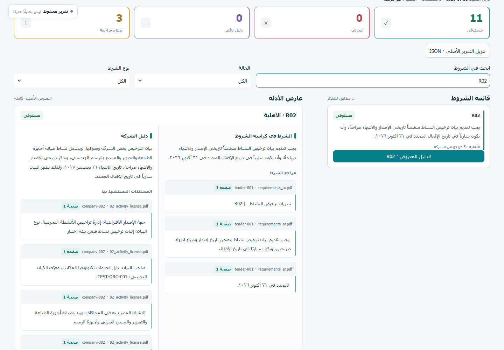
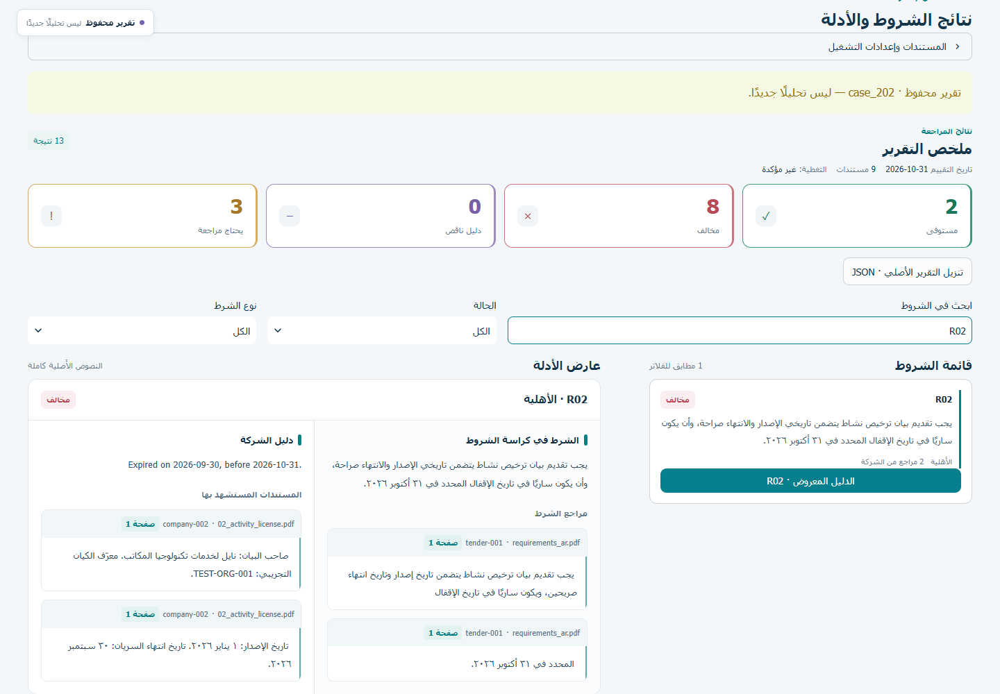
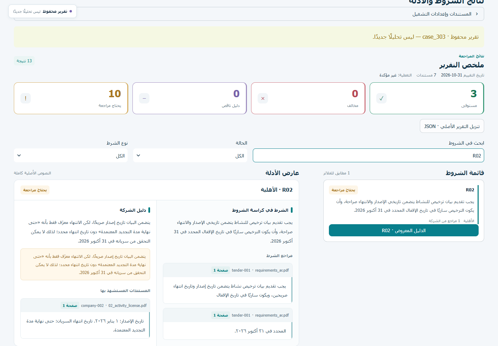
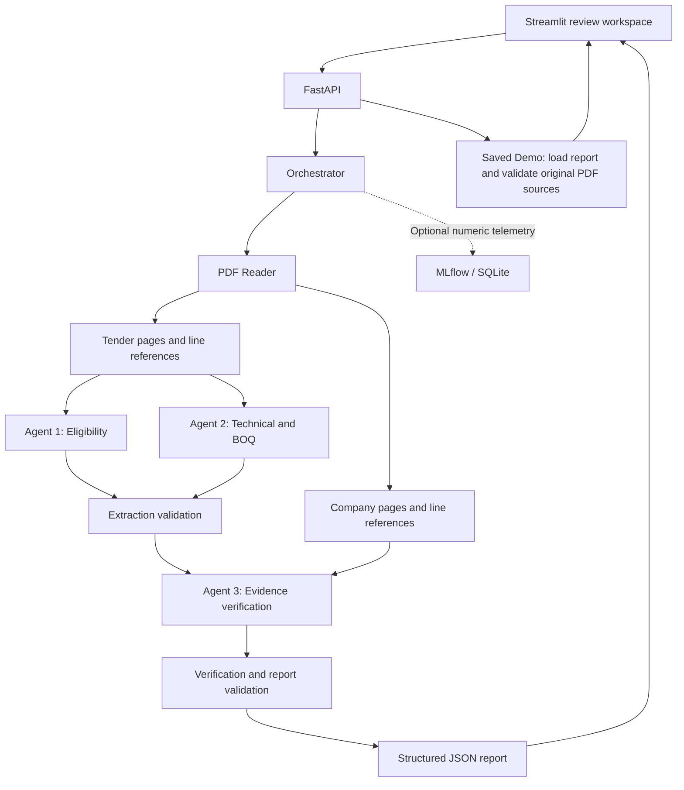

<div align="center">

# TenderProof AI

### Bid with Evidence. Decide with Confidence.

**AI-assisted tender review for Arabic documents, with decisions you can trace to the source.**

A **Samsung Innovation Campus** team project connecting document analysis, evidence verification, and a practical review workspace.

[Overview](#overview) · [Quick Start](#quick-start) · [Demo Scenarios](#demo-scenarios) · [AI Evaluation & MLflow](#ai-evaluation--mlflow) · [Documentation](#documentation)

</div>



<p align="center"><em>Actual application screenshot · Arabic RTL interface · Saved Demo, not a new AI analysis.</em></p>

---

## Overview

TenderProof AI helps bid teams review a tender's eligibility requirements, technical conditions, and bill of quantities against company documents. It produces an explainable report that connects findings to **original quotations, document names, and PDF page numbers**.

The project combines a Python AI core, a FastAPI service, a Streamlit review interface, Docker deployment, and optional MLflow tracking. It is designed to support human review before a bid submission.

**A finding is useful when a reviewer can inspect its evidence, understand its reasoning, and see what remains uncertain.**

## Problem

A tender submission can involve many conditions spread across Arabic PDFs, tables, licenses, experience records, and financial documents. Manual review makes it difficult to:

- Identify every relevant requirement and its source.
- Match a requirement to the correct company evidence and scope.
- Notice an expired license, an explicit contradiction, or an unclear validity date.
- Distinguish missing proof from evidence of non-compliance.
- Explain a decision to another reviewer without repeating the entire document search.

TenderProof targets bid and procurement teams, suppliers, service contractors, and document reviewers working with this process.

## Solution

**Extract → Match → Verify → Explain**

TenderProof extracts requirements, compares them with the available company documents, validates source references, and presents an evidence-linked report. Four statuses preserve the distinction between a supported decision and a case that needs more information:

| Status | Meaning |
|---|---|
| `SATISFIED` | Sufficient, clear evidence supports the requirement. |
| `CONTRADICTED` | Explicit evidence conflicts with the requirement. |
| `MISSING_EVIDENCE` | Required evidence was not found in a company-document set confirmed complete and sufficiently readable. |
| `NEEDS_REVIEW` | Uncertainty, incomplete coverage, or insufficient evidence prevents a reliable decision. |

A document that was not supplied is **not automatically a contradiction**. An unknown quantity is **not zero**. A quoted sentence must come from its referenced page.

## Key Features

| Capability | What is implemented |
|---|---|
| Arabic document reading | Native PDF text extraction, Arabic text handling, original page numbers, and scoped extraction warnings. |
| Three specialized agents | Eligibility extraction; technical and BOQ extraction; company-evidence verification. |
| Evidence verification | LLMs return supplied line IDs; Python restores the original citations and validates them. |
| Quantity and date checks | Grounded Arabic/Western numeric quantities, clear supported word or dual forms, validity dates, and supported duration comparisons. |
| Reviewer workspace | Arabic RTL interface, four summary cards, searchable/filterable requirements, and a side-by-side evidence inspector. |
| Shareable reports | Download the original structured JSON report without changing its decisions or citations. |
| Transparent operating modes | Distinct Saved Demo, MOCK, and Real AI labels. |
| Optional MLflow | Stage timings, counts, and validation metrics; tracking failure does not stop analysis. |
| Local Docker deployment | Separate API and UI services, runtime-only secrets, and persistent runtime storage. |

## How It Works

1. **Provide the documents.** Upload one tender PDF and multiple company PDFs, or open a supplied Saved Demo.
2. **Read the sources.** `pdf_reader.read_pdf()` preserves page references and records extraction uncertainty.
3. **Extract requirements.** Agent 1 identifies eligibility conditions; Agent 2 identifies technical requirements and BOQ items.
4. **Validate extraction.** Python resolves line references and checks contracts, citations, quantities, and target identifiers.
5. **Verify the company.** Agent 3 assesses company evidence using the supplied evaluation date and completeness information.
6. **Inspect the report.** Review statuses, explanations, source quotations, PDF pages, warnings, and the downloadable JSON.

The current orchestrator executes Agent 1, then Agent 2, then Agent 3 after extraction validation. These are fixed pipeline stages, not autonomous agents.

### Evidence that explains the outcome

| Explicit contradiction | A reason to keep human review |
|---|---|
|  |  |
| `case_202` identifies a license that expired before the reference date. | `case_303` retains `NEEDS_REVIEW` when the actual expiry date is unclear. |

These are real screenshots of saved synthetic scenarios. They are not recordings of new inference requests.

## Architecture



| File or directory | Responsibility |
|---|---|
| [`pdf_reader.py`](pdf_reader.py), [`arabic_utils.py`](arabic_utils.py) | PDF reading and Arabic text utilities. |
| [`agent1.py`](agent1.py) | Eligibility requirement extraction. |
| [`agent2.py`](agent2.py) | Technical requirements, BOQ items, quantities, and units. |
| [`agent3.py`](agent3.py) | Company evidence assessment and supported findings. |
| [`validation.py`](validation.py) | Data contracts, exact citations, quantities, dates, and report checks. |
| [`models.py`](models.py), `*_schema.py` | Shared data structures and structured-output schemas. |
| [`llm_client.py`](llm_client.py), [`openai_adapter.py`](openai_adapter.py) | LLM interface and the OpenAI implementation used by the application. |
| [`orchestrator.py`](orchestrator.py) | Pipeline sequencing and report assembly. |
| [`web/api.py`](web/api.py), [`web/app.py`](web/app.py) | FastAPI endpoints and the Streamlit interface. |
| [`tracker.py`](tracker.py) | Optional, failure-isolated operational MLflow tracking. |
| [`demo/`](demo/), [`tests/`](tests/) | Synthetic scenarios, saved reports, fixtures, and offline tests. |

## Tech Stack

| Layer | Technology |
|---|---|
| Language | Python 3.12+ |
| Document extraction | pypdf and existing Arabic text utilities |
| Application AI | OpenAI API through `openai_adapter.py`; structured JSON and supplied line references |
| Backend | FastAPI, Uvicorn |
| Review interface | Streamlit, Arabic RTL styling |
| Experiment tracking | MLflow, SQLite |
| Packaging | Docker, Docker Compose, Windows batch launchers |
| Offline verification | pytest, pytest-asyncio, fake LLM clients, saved evidence |

Gemini and Nemotron appear in the **historical development benchmark**. This does not mean the application exposes those providers as interchangeable production adapters.

## Quick Start

### 1. Get the project

```bash
git clone --branch main https://github.com/Mohamed934789/TenderProof-Core.git
cd TenderProof-Core
```

Install **Docker Desktop with Linux containers** on Windows, or Docker Engine with Compose on Linux. The first image build needs internet access. Keep enough free disk space for the image and Docker's storage.

### 2. Start the free demo

**Windows:** clone or extract to a writable folder on `D:`, start Docker Desktop, and double-click **[`START_TENDERPROOF.bat`](START_TENDERPROOF.bat)**. Use **[`STOP_TENDERPROOF.bat`](STOP_TENDERPROOF.bat)** to stop the app without deleting documents, secrets, or attempt locks.

**Docker Compose:** on a fresh **Linux** checkout, first create the writable bind-mount directories for the image's non-root UID (Windows users can skip this preparation):

```bash
mkdir -p runtime/docker/api runtime/docker/ui
sudo chown 10001:10001 runtime/docker/api runtime/docker/ui
```

Then start the services:

```bash
docker compose up --build -d --wait
```

| Service | Local address |
|---|---|
| Streamlit workspace | http://127.0.0.1:8503 |
| FastAPI documentation | http://127.0.0.1:8002/docs |
| API health | http://127.0.0.1:8002/health |

If Windows resolves an extensionless `docker` file instead of the CLI, use the official executable from PowerShell:

```powershell
& "C:\Program Files\Docker\Docker\resources\bin\docker.exe" compose up --build -d --wait
```

Do not run multiple copies on the same ports, and do not restart containers during a paid analysis.

### 3. Open a Saved Demo

In the interface, select **Demo Mode**, choose a scenario, and click **Display saved report** (`عرض التقرير المحفوظ`). Inspect the status cards, search for `R02`, open its evidence, and download JSON.

**No API key or paid inference is required.** The saved report is validated against the supplied PDFs and clearly labeled as saved. MOCK checks the document pipeline without LLM extraction; an empty findings list in MOCK is expected.

<details>
<summary><strong>Run locally without Docker — Windows / PowerShell</strong></summary>

Use Python 3.12+ and a project folder on `D:`. Run the following from the repository root:

```powershell
py -3.12 -m venv .venv
.\.venv\Scripts\python.exe -m pip install -r web/requirements.txt
$env:TENDERPROOF_RUNTIME_DIR="$PWD/runtime"
$env:TENDERPROOF_DEMO_DIR="$PWD/demo"
$env:TENDERPROOF_ALLOW_PAID_API="0"
$env:TENDERPROOF_SINGLE_AI_RUN="1"
.\.venv\Scripts\python.exe -m uvicorn web.api:app --host 127.0.0.1 --port 8000 --no-access-log
```

In a second terminal:

```powershell
$env:TENDERPROOF_API_URL="http://127.0.0.1:8000"
.\.venv\Scripts\python.exe -m streamlit run web/app.py --server.address 127.0.0.1 --server.port 8501
```

Native UI: http://127.0.0.1:8501. Native API: http://127.0.0.1:8000/docs.

</details>

### Optional: enable Real AI

Real AI is **disabled by default on this branch**. It requires your own OpenAI API key, available credit, permission to send the documents to OpenAI, and explicit approval of the cost.

1. Create `.secrets/openai_api_key` locally in the repository root. Put only the key in that file using a local editor. Do not commit, paste into a command, or share it.
2. On Windows, double-click **[`START_REAL_AI.bat`](START_REAL_AI.bat)**. Alternatively:

   ```bash
   docker compose -f docker-compose.yml -f docker-compose.ai.yml up --build -d --wait
   ```

3. Select file upload, then **Real AI** in Advanced Settings. Upload the PDFs, set the reference date, and approve the document transfer and cost before pressing **Start review**.
4. For the supplied fictional PDFs, explicitly enable `synthetic-test`. Leave company-document completeness unconfirmed unless you have a documented basis to confirm it.

The Docker override mounts the secret into the API at runtime; it does not put the key in the image or UI. For native API operation, use a local `.env` based on [`.env.example`](.env.example), explicitly set `TENDERPROOF_ALLOW_PAID_API=1`, and restart the API. Use the configured model `gpt-6-luna`; the web safety gate permits that model only.

**The web API preserves a single-attempt lock, a maximum of three generation calls, no automatic retries, and a conservative reservation ceiling of $0.50.** The input-token count and output limits are checked before generation. This is an estimate/reservation guard, not an invoiced price guarantee. These web safeguards do not describe direct, separately invoked CLI AI usage.

- `READY` means configuration readiness, not a successful provider request or a balance check.
- The Docker attempt lock is `runtime/docker/api/real-ai-e2e/single-attempt.lock`; native operation uses `runtime/real-ai-e2e/`.
- START/STOP do not reset a consumed attempt. **Do not delete the lock or change runtime to rearm it.** Additional paid work requires fresh authorization.
- To disable Real AI, start the base Compose file alone or use `START_TENDERPROOF.bat`. For native operation, set `TENDERPROOF_ALLOW_PAID_API=0` and restart the API.

## Demo Scenarios

All supplied scenario PDFs are **fictional test documents**, with evaluation date **2026-10-31**. Do not mix company files between scenarios.

| Scenario | Company PDFs | Evidence to inspect |
|---|---:|---|
| [`case_101`](demo/case_101/) | 8 | A valid activity license supports `R02`. |
| [`case_202`](demo/case_202/) | 8 | An explicitly expired license produces `CONTRADICTED` for `R02`. |
| [`case_303`](demo/case_303/) | 6 | An unspecified expiry date keeps `R02` under review. |

For each scenario, upload `requirements_ar.pdf` as the tender, and all `0*.pdf` files in the **same folder** as company documents. The JSON report is for viewing, not a PDF upload.

- Cases 101 and 202 contain company files `01` through `08`.
- Case 303 intentionally omits `03_tax_statement.pdf` and `05_maintenance_authorization.pdf`. Do not fill the gaps from another scenario.
- `demo/manifest.json` binds the saved reports to their PDFs. Keep file names unchanged.
- The local `ida-335.pdf` fixture is optional and is not needed for these demos.

The reader does not establish that the company-document set is complete. Missing-document cases must therefore retain review unless completeness is explicitly established.

## AI Evaluation & MLflow

### Exploratory development benchmark

The [benchmark report](docs/TENDERPROOF_BENCHMARK_FINAL_REPORT.md) evaluates Agent 3 on frozen conditions and evidence from synthetic scenarios already used in development.

**Label source: `LLM_JUDGE_PROVISIONAL` from Claude Web. This is LLM-Judged Development, not Human Gold or an independent Holdout.** Of 27 development records, 18 were provisionally accepted and nine remain Pending Review.

| Model | Completed / planned | Actual outcome |
|---|---:|---|
| GPT — `gpt-6-luna` | 18 / 18 | Completed; existing results were reused. |
| Gemini — `gemini-3.6-flash` | 2 / 18 | Stopped on an HTTPError; the original HTTP code/details were not retained. |
| Nemotron Ultra — OpenRouter `:free` | 16 / 18 | Stopped on an upstream idle timeout; no paid fallback was used. |

The three-way benchmark **did not complete**. Compare GPT and Nemotron only on the 16 completed cases they share. Provider failures, partial coverage, and the `case_101:R02` disagreement are documented in the report.

### Optional application tracking

```powershell
$env:TENDERPROOF_MLFLOW_ENABLED="1"
docker compose --profile tracking up --build -d --wait
```

On Windows with a Docker PATH issue, replace `docker` with the full executable shown above. Open http://127.0.0.1:5001 and select **Model training → Runs → TenderProof_Evaluation**. Generate a free MOCK run or open a Saved Demo to see operational records. The GenAI trace overview is not used by this integration.

- The application records stage timings, counts, and validation metrics. It does not automatically compute benchmark precision or F1.
- Document text, quotations, filenames, keys, and full model outputs are not logged by `tracker.py`.
- Tracking is optional and failure-isolated. SQLite persists at `runtime/docker/api/mlflow/mlflow.db` in Docker.
- The historical benchmark used a separate experiment, `TenderProof-LLM-Benchmark`. Its private database is not bundled; shareable comparison artifacts are in [`docs/benchmark/`](docs/benchmark/).
- To combine tracking with Real AI, explicitly include both Compose files along with `--profile tracking`. Tracking itself does not authorize inference.

## Results

### Saved Demo findings

| Saved scenario | SATISFIED | CONTRADICTED | MISSING_EVIDENCE | NEEDS_REVIEW |
|---|---:|---:|---:|---:|
| case_101 | 11 | 0 | 0 | 3 |
| case_202 | 2 | 8 | 0 | 3 |
| case_303 | 3 | 0 | 0 | 10 |

These are **saved findings**, not fresh model outputs. Case 101 comes from an earlier OpenAI acceptance report; cases 202 and 303 are preserved replay reports. All three keep BOQ review warnings. `MISSING_EVIDENCE` is zero here because document completeness is unconfirmed, not because that status is unsupported.

### Matched benchmark subset: 16 shared cases

| Model | Agreement with Claude's provisional labels | Supported-class macro precision | Recall | F1 | Exact citations |
|---|---:|---:|---:|---:|---:|
| GPT, reused results | 16 / 16 | 100% | 100% | 100% | 129 / 129 |
| Nemotron Ultra | 15 / 16 | 100% | 95% | 97.37% | 89 / 89 |

**Scope matters:** the reference subset has 10 `SATISFIED` and six `CONTRADICTED` labels. P/R/F1 cover those two supported classes, not all four decision states. These exploratory numbers do not establish general accuracy, human agreement, or performance on unseen tenders. [Source CSV](docs/benchmark/comparison.csv) · [Coverage and metrics](docs/benchmark/comparison.json).

GPT's recorded 18-case cost estimate was approximately **$0.02954**, not a final invoice. Nemotron's recorded provider cost was **$0**; coverage and provider routes differed. These are not an equal-workload pricing comparison.

### Verification evidence

The integration record reports **193 offline tests passed, 16 subtests passed, and six optional tests skipped**. It also records Docker/API/UI checks, real PDF uploads in MOCK, Saved Demo citation validation, JSON downloads, and Real AI configuration readiness. [Integration verification](docs/INTEGRATION_VERIFICATION.md).

An [earlier live OpenAI web trial](docs/evidence/previous-real-ai-acceptance.json) is retained separately. It is not the same run as the Saved Demo. The integration verification used free checks and readiness checks; it did not claim a new paid acceptance run.

No comprehensive tests or paid API calls were run for this README update.

## Limitations

- **Native text, not OCR:** image-only or damaged PDFs may need external preparation or human review.
- **Tables remain a challenge:** native extraction does not guarantee the visual order or structure of every Arabic table.
- **Coverage is not assumed:** a readable page does not prove that all documents were supplied or every requirement was found.
- **Citation validity is a boundary, not full correctness:** an exact quotation does not establish document authenticity or guarantee a correct interpretation.
- **Human review remains essential:** this is decision support, not a legal eligibility guarantee or automatic bid approval.
- **Evaluation is limited:** small synthetic development data, provisional LLM labels, incomplete provider runs, and no independent Human Gold/Holdout.
- **Local demo deployment:** loopback-bound services are intended for local use. The repository does not provide a hardened public hosting/authentication setup.

## Team

A five-member collaboration, organized around the responsibilities recorded in [`TEAM_TASKS.md`](TEAM_TASKS.md):

| Working area | Main responsibility |
|---|---|
| Document AI & PDF | Arabic PDF reading, page quality, and source preservation. |
| Eligibility | Agent 1 requirements, references, and extraction checks. |
| BOQ & Technical | Agent 2 quantities, units, specifications, and uncertainty. |
| Evidence Verification | Agent 3 company-evidence assessment and supported decisions. |
| Integration & Validation | Shared contracts, orchestration, validation, and integration checks. |

The task document is a historical planning record, not a current implementation checklist. Authorship is preserved in the [Git history](https://github.com/Mohamed934789/TenderProof-Core/commits/main/) and [contributors view](https://github.com/Mohamed934789/TenderProof-Core/graphs/contributors).

## Documentation

| Resource | What to open it for |
|---|---|
| [Demo rehearsal](docs/DEMO_REHEARSAL.md) | A 4–5 minute walkthrough and manual presentation steps. |
| [Integration verification](docs/INTEGRATION_VERIFICATION.md) | What the integrated version actually verified. |
| [Benchmark report](docs/TENDERPROOF_BENCHMARK_FINAL_REPORT.md) | Model coverage, valid comparisons, disagreements, and caveats. |
| [Benchmark artifacts](docs/benchmark/) | Source CSV/JSON and provider-failure diagnosis. |
| [Acceptance evidence](docs/evidence/) | Actual screenshots and historical acceptance records. |
| [PDF reader notes](PDF_READER_NOTES.md) | Extraction boundaries and reader context. |
| [Offline tests](tests/README.md) | Test organization and local prerequisites. |
| [Public release review](docs/PUBLIC_RELEASE_REVIEW.md) | Security review scope and remaining publication considerations. |

No project `LICENSE` file is currently included. Confirm code, fixture, and dataset redistribution permissions with the contributors before public release.

---

<div align="center">

**TenderProof AI** · **Bid with Evidence. Decide with Confidence.**

*Evidence you can inspect. Decisions you can review.*

</div>

## Portfolio reliability update

Explicit future validity starts are checked in Python before accepting a model support assessment. Invalid or conflicting labelled starts remain under review. The core offline CI uses `requirements-dev.txt`; MLflow tests remain optional. Set `TENDERPROOF_RUNTIME_DIR` to any writable private directory on Windows or Linux. `requirements.txt` retains the optional tracking stack for the existing Docker profile. No general eligibility accuracy is claimed.
